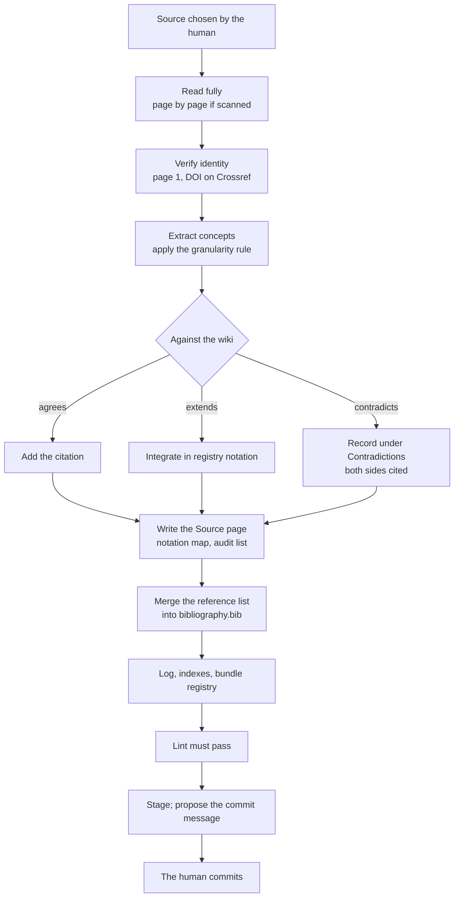

# How a bundle works

This page explains the ideas you meet on every page of a bundle. The binding text is the
[constitution](/reference/constitution); the reasons behind each rule are in the [decision record](/reference/decisions).

## Three layers

| Layer | What it holds | Who writes it |
| --- | --- | --- |
| **Layer 0: law** | `CLAUDE.md` (repository law), each bundle's `CLAUDE.md` (bundle law), `DECISIONS.md`, `tools/` | the human, after discussion with the compiler |
| **Layer 1: sources** | the source archive (PDFs, referenced in place) and `raw/` captures of anything without a durable home (web pages, notes) | nobody: immutable once captured |
| **Layer 2: the wiki** | `<bundle>/wiki/`: concept pages, Source pages, notation registry, indexes, log, bibliography | the compiler |

Layer 1 is never modified, renamed or deleted, so the wiki can always be audited against, or recompiled from, the
sources it cites.

## Two roles

| | The human | The compiler (Claude) |
| --- | --- | --- |
| Sources | chooses, reviews and vouches for them | reads them fully (page by page when a PDF is a scan), never modifies them |
| Content | audits pages, challenges claims, closes contradictions by decision | creates and merges pages, writes notation maps, records contradictions |
| Quality | spot-checks, asks for audits | runs the linter at every ingestion, a deep audit every ten |
| Git | **commits** | stages and proposes the commit message, never commits |

Sources are trusted because a human chose them: trust is a property of the ingestion act, not a field on the page.
Their *identity* is still verified (title, authors and venue from the first page, DOI against Crossref), because
filenames and embedded metadata are often wrong.

## Page types

Every page except the reserved ones (`index.md`, `log.md`, `bibliography.md`) is a **concept document**: YAML
frontmatter with a `type`, then Markdown. The type decides the folder.

| `type` | Folder | Covers |
| --- | --- | --- |
| `Definition` | `definitions/` | precise domain terms |
| `Method` | `methods/` | algorithms and schemes |
| `Operator` | `operators/` | discrete operators with an algebraic identity |
| `Result` | `results/` | theorems, proved properties, impossibility results |
| `Property` | `properties/` | constraints and invariants a method can hold |
| `Benchmark` | `benchmarks/` | standard test problems |
| `Software` | `software/` | codes that embody methods |
| `Source` | `sources/` | one page per ingested source |

A page has to earn its place: two or more sources touch it, or one source presents it as its main contribution, or it
states an algebraic identity, or it is a definition that decides classifications. Anything less stays inline in its
parent page. There are no stubs. The full schema of each type is in
[Page types and frontmatter](/reference/page-types).

## Claim kind {#claim-kind}

Every concept page carries `status`:

- `established`: a published, peer-reviewed result;
- `hypothesis`: a claim that a published source could still overturn, including claims from the human's own notes.

`status` is about the kind of claim, not about trust. A conjecture is a `Result` page with `status: hypothesis`. The
site shows the status as a badge; the page graph draws hypothesis pages with a dashed outline.

## Notation {#notation}

Papers on one subject write it in a dozen notations. Each bundle has one **notation registry**, `wiki/notation.md`,
which is normative: concept pages may only use its symbols. When a new family of operators appears, the registry is
extended (and the extension logged) before any page uses it.

The translation is recorded on the other side too: every Source page has a `# Notation map`, a table from the
source's own symbols to the registry's. It is the audit trail of each translation, so you can read the original paper
with the wiki open next to it.

## Contradictions {#contradictions}

When a new source disagrees with a page, the compiler does not overwrite the page. It adds a `## Contradictions`
section (or an entry to it) that states both claims, attributes each and cites both. Two rules govern it:

- **Recency never wins.** A 2024 paper does not overrule a 1999 paper by being newer.
- **Nothing closes silently.** An entry closes only when a source explicitly supersedes another, or when the human
  closes it by decision; a closure by decision is recorded and marked `hypothesis`.

Contested pages are among the most useful in a bundle: they show where a literature is not settled. The
[bundle cards](/bundles/) count them.

## The citation record {#citation-record}

Ingesting a paper means reading its reference list too. Every work an ingested source cites becomes an entry of the
bundle's `wiki/bibliography.bib`, whether or not it is itself ingested, with a `citedby` field listing the ingested
sources that cite it. An entry whose key matches a Source page *is* that source.

This gives each bundle two things for free:

- **a citation graph**: which ingested sources cite which works;
- **an ingestion frontier**: works cited by the bundle but not yet ingested, ranked by how often they are cited. It is
  the bundle's own reading list, derived from the literature rather than chosen by hand.

`wiki/bibliography.md` is a generated view of the `.bib`, rebuilt by a tool and never edited. Details in
[Bibliography format](/reference/bibliography).

## Derived progress

Nothing about progress is stored. A source is ingested if and only if its Source page exists; a reference list is
merged if and only if its source appears in some `citedby` field. There is no queue file to go stale: the worklist is
the source archive minus the Source pages (`tools/worklist.sh`), and the state of an interrupted session is whatever
`git status` shows.

## The ingestion of one source

Each source is one atomic unit: it ends staged and complete, or it is discarded.

## Bundles are independent

Each bundle is a self-contained wiki on one domain, agnostic of every other bundle and of every other repository: no
page links across bundles, and a claim never rests on another bundle's pages. A paper relevant to two domains is
compiled twice, once by each bundle, for what it says about that bundle's domain.

The site respects this. The [bundle map](/bundles/#the-bundle-map) shows overlaps between bundles (shared cited works,
papers compiled in both, concepts with the same name), but computes them when the site is built, from the files. The
bundles themselves stay unaware of one another.

Next: the [tutorial](/manual/), starting with [reading a bundle](/manual/tutorial/01-reading).
